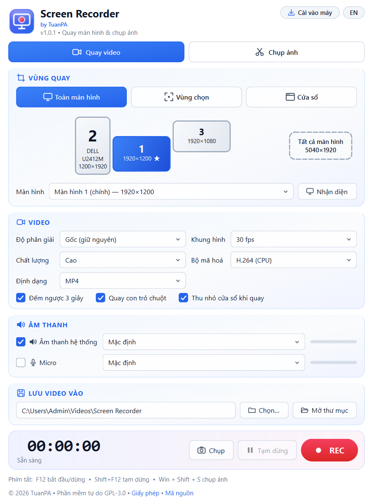
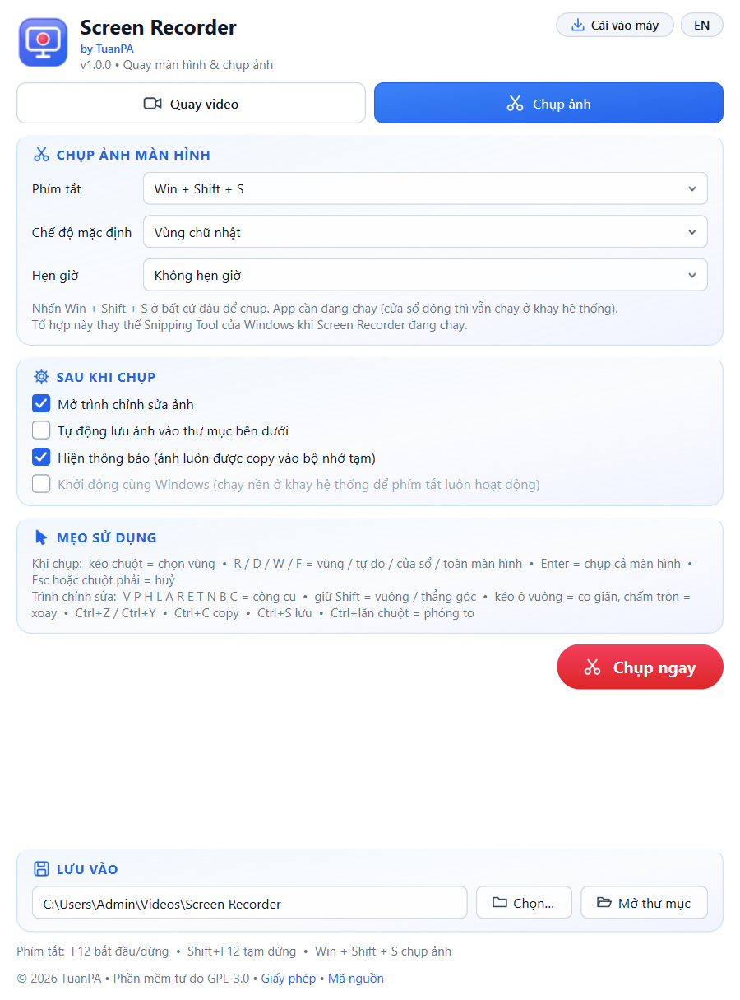
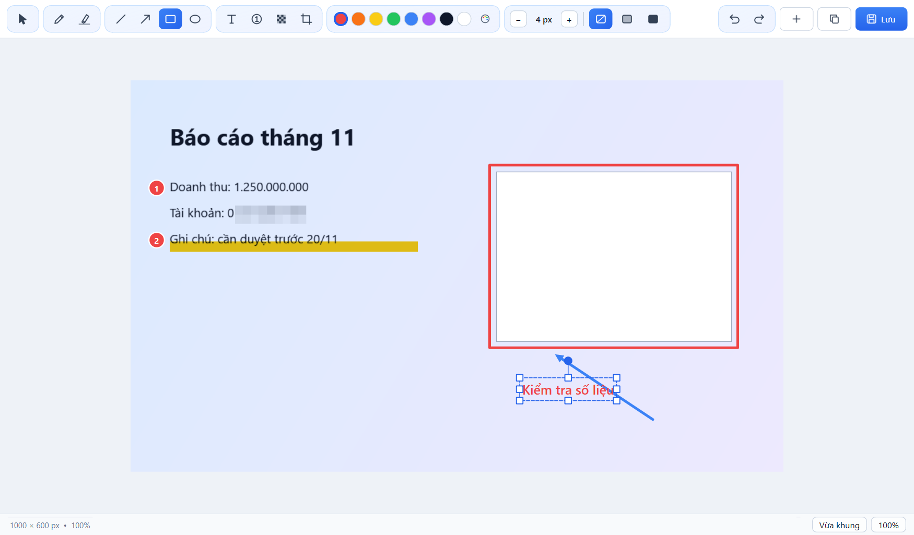
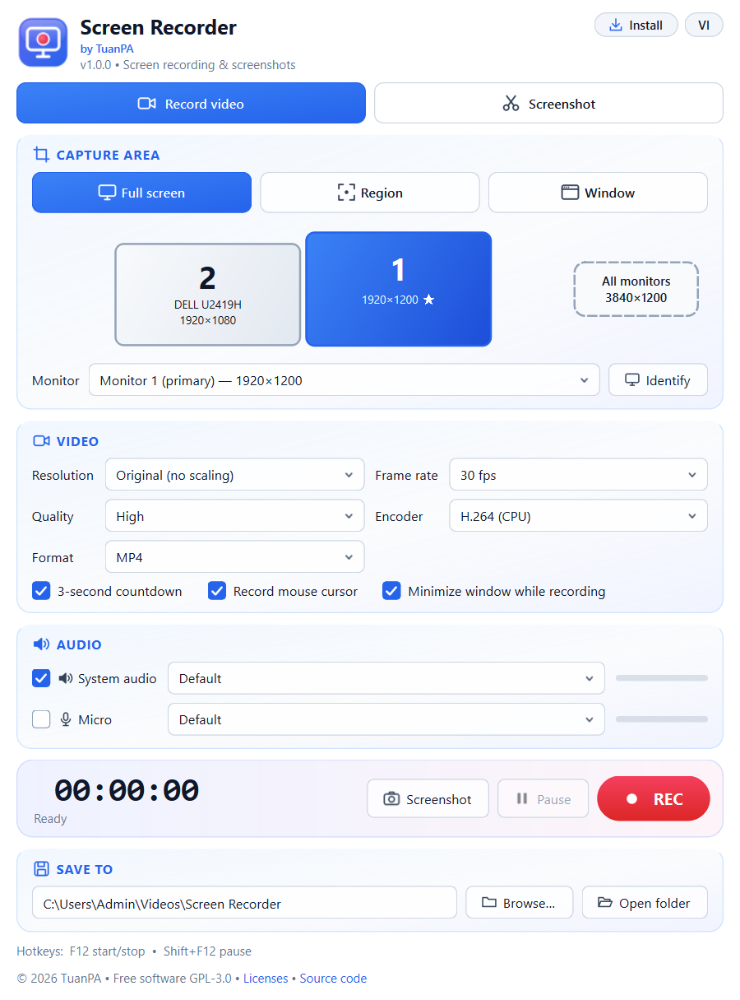

# Screen Recorder

**Quay màn hình & chụp ảnh cho Windows** – quay video kèm âm thanh, chụp ảnh kiểu Snipping Tool với trình chỉnh sửa ảnh đầy đủ. Giao diện tiếng Việt / English, chạy portable (1 file exe) hoặc cài cho tài khoản hiện tại, không cần quyền admin.

*Screen recording & screenshots for Windows – record video with audio, Snipping-Tool-style capture with a full image editor. Vietnamese / English UI, portable single exe or per-user install (no admin). [English below](#english).*



## Tính năng

**Quay video**
- Chọn **toàn màn hình** (sơ đồ màn hình trực quan, nút *Nhận diện*, hỗ trợ nhiều màn hình / tất cả màn hình), **vùng chọn** (kéo chuột hoặc nhập X/Y/W/H, cỡ nhanh 1080p/720p/dọc…) hoặc **cửa sổ**.
- Độ phân giải: gốc, 4K, 2K, 1080p, 720p, 480p, 360p • 10–60 fps • 4 mức chất lượng • MP4 / MKV.
- Bộ mã hoá H.264/H.265 CPU, tự nhận **NVIDIA NVENC / Intel QuickSync / AMD AMF** nếu máy có.
- **Âm thanh hệ thống** (WASAPI loopback) + **micro**, chọn thiết bị, thanh đo mức âm; tự trộn và luôn khớp hình – tiếng kể cả khi tạm dừng.
- Tạm dừng / tiếp tục, đếm ngược 3 giây, viền đỏ quanh vùng đang quay, chạy nền ở khay hệ thống.
- Phím tắt: **F12** bắt đầu/dừng, **Shift+F12** tạm dừng.

**Chụp ảnh (giống Snipping Tool)**
- Phím tắt toàn cục mặc định **Win + Shift + S** (thay Snipping Tool khi app chạy), hoặc Print Screen, Ctrl+Shift+S…
- Chế độ **vùng chữ nhật, tự do (theo nét kéo chuột), cửa sổ, toàn màn hình**; hẹn giờ 3/5/10 giây; màn hình được “đóng băng” khi chọn.
- Ảnh **tự copy vào bộ nhớ tạm**, thông báo kèm ảnh thu nhỏ, có thể tự lưu PNG.



**Trình chỉnh sửa ảnh**
- Bút, bút dạ quang, đường thẳng, mũi tên, hình chữ nhật, elip (tô mờ/đặc), chữ, đánh số thứ tự, **làm mờ che thông tin**, cắt ảnh.
- **Di chuyển, co giãn, xoay** mọi hình đã vẽ; 8 màu nhanh + bảng màu; độ dày nét −/+.
- Hoàn tác / làm lại không giới hạn; mỗi thay đổi tự cập nhật clipboard; Ctrl+S lưu nhanh, Ctrl+Shift+S lưu PNG/JPG.



## Tải về & cài đặt

1. Tải `ScreenRecorder-v1.0.2-win64.exe` ở mục [Releases](../../releases) (kiểm tra SHA-256 trong `SHA256SUMS.txt`).
2. Chạy trực tiếp (portable – cài đặt lưu ở `ScreenRecorder.ini` cạnh file exe), **hoặc** bấm **Cài vào máy** trong app để cài vào `%LOCALAPPDATA%\Programs\Screen Recorder` (khởi động nhanh hơn, có lối tắt Start Menu/Desktop, gỡ trong *Settings › Apps*).

Yêu cầu: Windows 10/11 64-bit. Hướng dẫn chi tiết: [docs/USER_GUIDE.md](docs/USER_GUIDE.md).

## Build từ mã nguồn

```bat
pip install -r requirements.txt
build.bat
```
Kết quả: `src\dist\Screen Recorder.exe`. Chi tiết: [docs/BUILD.md](docs/BUILD.md).

## Giấy phép

Copyright © 2026 TuanPA – <tuanpa1702@gmail.com>

Screen Recorder là phần mềm tự do theo **GNU General Public License v3.0** – xem [LICENSE](LICENSE). Bạn được dùng, sửa và phân phối lại; bản phân phối lại phải giữ giấy phép GPL-3.0 và cung cấp mã nguồn. Phần mềm được cung cấp **không kèm bất kỳ bảo hành nào**.

File exe đóng gói kèm FFmpeg (GPL-3.0), Qt/PySide6 (LGPL-3.0), PyAudioWPatch (Apache-2.0), PortAudio (MIT), numpy (BSD), pywin32 (PSF), Python (PSF). Xem [NOTICE.md](NOTICE.md) và thư mục `licenses` trong app (*Giấy phép* ở chân trang).

---

## English

Screen Recorder is a Windows screen recorder and screenshot tool.

- **Record**: full screen (visual monitor picker, multi-monitor / all monitors), region or window; original…360p, 10–60 fps, MP4/MKV, H.264/H.265 with NVENC/QuickSync/AMF when available; system audio + microphone kept in sync across pauses; F12 / Shift+F12.
- **Snip**: global hotkey (default Win+Shift+S, replacing Snipping Tool while running), rectangle / freeform / window / full screen, delay timer, auto copy to clipboard, notification, optional auto-save.
- **Editor**: pen, highlighter, line, arrow, rectangle, ellipse, text, step numbers, blur/redact, crop; move / resize / rotate any shape; unlimited undo; clipboard always updated.
- **UI** in Vietnamese and English, portable or per-user install (no admin).



Build: `pip install -r requirements.txt` then `build.bat`. License: **GPL-3.0** – see [LICENSE](LICENSE) and [NOTICE.md](NOTICE.md). Contact: TuanPA – tuanpa1702@gmail.com.
