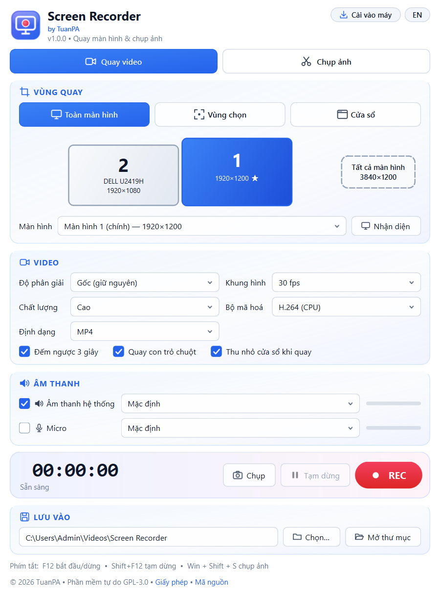
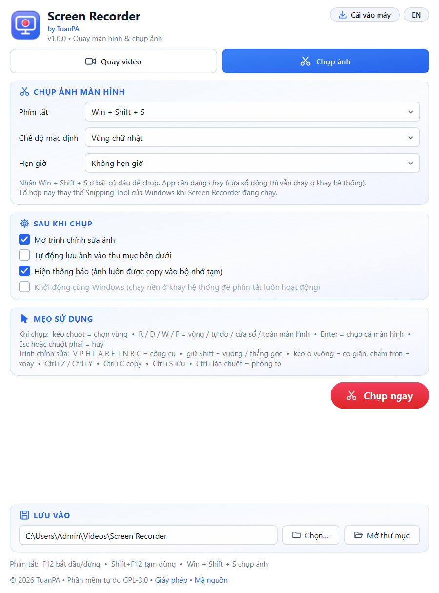
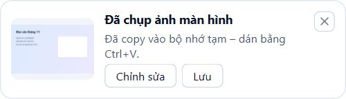
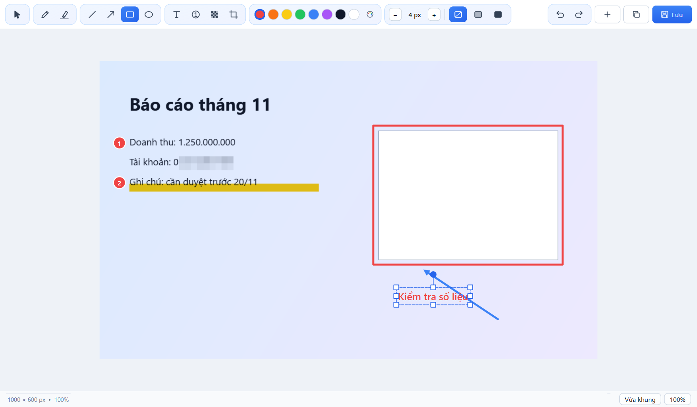

# Hướng dẫn sử dụng Screen Recorder

## 1. Chạy app
- **Portable**: chạy `Screen Recorder.exe` ở bất kỳ đâu. Cài đặt lưu trong `ScreenRecorder.ini` cạnh file exe. Bản 1 file phải tự giải nén mỗi lần mở nên khởi động chậm hơn (~10 giây).
- **Cài vào máy**: bấm **Cài vào máy** (góc trên phải). App được cài cho tài khoản hiện tại vào `%LOCALAPPDATA%\Programs\Screen Recorder` (không cần admin), tạo lối tắt Start Menu + Desktop, khởi động ~2–4 giây. Gỡ: nút **Gỡ cài đặt** trong bản đã cài hoặc *Settings › Apps › Screen Recorder*.
- Nút **EN / VI** đổi ngôn ngữ.
- Đóng cửa sổ thì app **vẫn chạy ở khay hệ thống** để phím tắt chụp ảnh hoạt động. Thoát hẳn: chuột phải biểu tượng ở khay › **Thoát**.

## 2. Quay video (tab *Quay video*)

1. **Vùng quay**
   - *Toàn màn hình*: bấm vào màn hình trên sơ đồ (hoặc ô *Tất cả màn hình*). Nút **Nhận diện** hiện số lớn trên từng màn hình. Sơ đồ tự cập nhật khi cắm/rút màn hình.
   - *Vùng chọn*: **Chọn vùng…** rồi kéo chuột (Esc/chuột phải để huỷ), hoặc nhập X/Y/W/H, hoặc chọn *Kích thước nhanh*.
   - *Cửa sổ*: chọn cửa sổ trong danh sách (⟳ để làm mới). App quay đúng khu vực của cửa sổ đó.
2. **Video**: độ phân giải, khung hình (fps), chất lượng, bộ mã hoá (H.264 CPU; NVENC/QuickSync/AMF nếu có), định dạng MP4 hoặc MKV (an toàn khi mất điện).
3. **Âm thanh**: *Âm thanh hệ thống* (tiếng phát ra loa) và/hoặc *Micro*, chọn thiết bị; thanh xanh cho biết mức âm khi đang quay.
4. **REC** (hoặc **F12**) để bắt đầu; **Tạm dừng** (Shift+F12); **DỪNG** (F12) để lưu. File `Rec_<ngày>_<giờ>.mp4` nằm ở thư mục *Lưu vào*.

## 3. Chụp ảnh (tab *Chụp ảnh*)

- **Phím tắt** mặc định **Win + Shift + S** – thay Snipping Tool của Windows khi app đang chạy. Có thể đổi sang Print Screen, Ctrl+Shift+S… hoặc tắt.
  - Nếu chọn Print Screen mà Windows vẫn mở Snipping Tool: *Settings › Accessibility › Keyboard* › tắt *Use the Print screen key to open screen capture*.
- **Chế độ**: vùng chữ nhật, **tự do** (kéo chuột theo hình bất kỳ), cửa sổ, toàn màn hình. Trong lúc chụp: `R` / `D` / `W` / `F` đổi chế độ, `Enter` chụp cả màn hình, `Esc` hoặc chuột phải để huỷ.
- **Hẹn giờ** 3/5/10 giây để kịp mở menu cần chụp.
- **Sau khi chụp**: ảnh luôn được copy vào bộ nhớ tạm (dán bằng Ctrl+V). Tuỳ chọn: mở trình chỉnh sửa, tự lưu vào `…\Screenshots`, hiện thông báo.
- **Khởi động cùng Windows** (bản exe): chạy nền ở khay để phím tắt luôn sẵn sàng.

## 4. Trình chỉnh sửa ảnh

| Công cụ | Phím | Ghi chú |
|---|---|---|
| Chọn / di chuyển | V | kéo ô vuông = co giãn (Shift giữ tỉ lệ), chấm tròn = xoay (Shift = bước 15°), Delete = xoá |
| Bút vẽ / Bút dạ quang | P / H | dạ quang trong suốt, chữ bên dưới vẫn đọc được |
| Đường thẳng / Mũi tên | L / A | Shift = thẳng góc 45° |
| Hình chữ nhật / Elip | R / E | Shift = vuông/tròn; 3 nút *không tô / tô mờ / tô đặc* |
| Chữ | T | bấm vào ảnh rồi gõ; nhấp đúp để sửa |
| Đánh số thứ tự | N | số tự tăng 1, 2, 3… |
| Làm mờ | B | che thông tin nhạy cảm (mã hoá pixel) |
| Cắt ảnh | C | kéo vùng cần giữ |

- Hình vừa vẽ có ngay khung co giãn/xoay, không cần chuyển sang công cụ Chọn.
- Màu: 8 màu nhanh + bảng màu. Độ dày nét / cỡ chữ: nút **− / +** (Ctrl+− / Ctrl+=). Chọn sẵn một hình rồi đổi màu/độ dày để áp cho hình đó.
- **Ctrl+Z / Ctrl+Y** hoàn tác/làm lại • **Ctrl+C** copy • **Ctrl+S** lưu nhanh • **Ctrl+Shift+S** lưu thành PNG/JPG • **Ctrl+N** chụp mới • Ctrl+lăn chuột phóng to, Ctrl+0 vừa khung, Ctrl+1 100 %.
- Mỗi thay đổi tự cập nhật ảnh trong bộ nhớ tạm.

## 5. Câu hỏi thường gặp
- **Không có tiếng hệ thống?** Kiểm tra thiết bị loa đang phát đúng là thiết bị đã chọn (hoặc để *Mặc định*).
- **Phím Win+Shift+S vẫn mở Snipping Tool?** Screen Recorder phải đang chạy (biểu tượng ở khay).
- **Antivirus cảnh báo?** File exe được đóng gói bằng PyInstaller và có phím tắt toàn cục (keyboard hook), một số phần mềm diệt virus có thể nghi ngờ nhầm. Bạn có thể tự build từ mã nguồn để kiểm chứng.

## 6. Giấy phép & liên hệ
Phần mềm tự do theo GPL-3.0 – xem [LICENSE](../LICENSE), [NOTICE.md](../NOTICE.md). Liên hệ: TuanPA – tuanpa1702@gmail.com.
